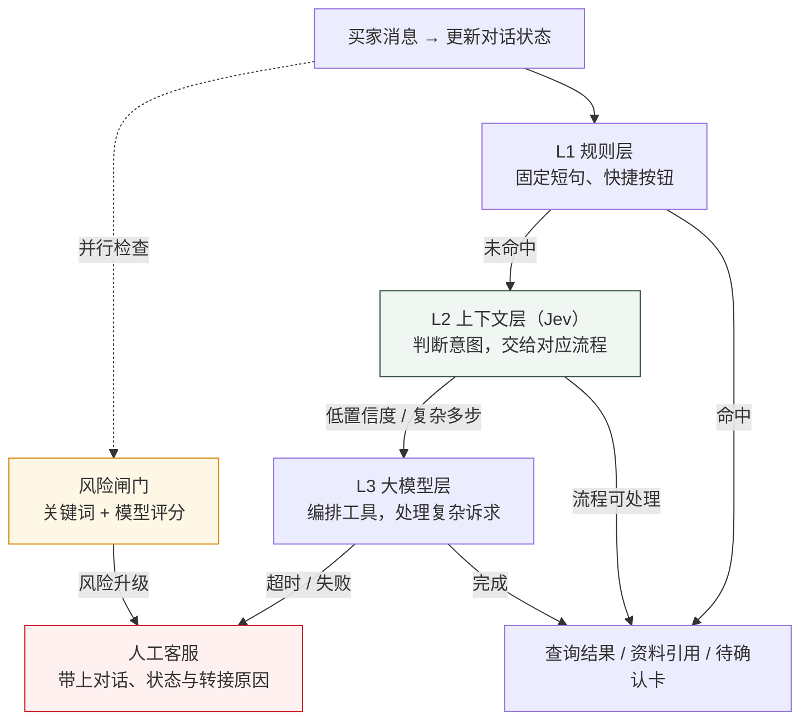
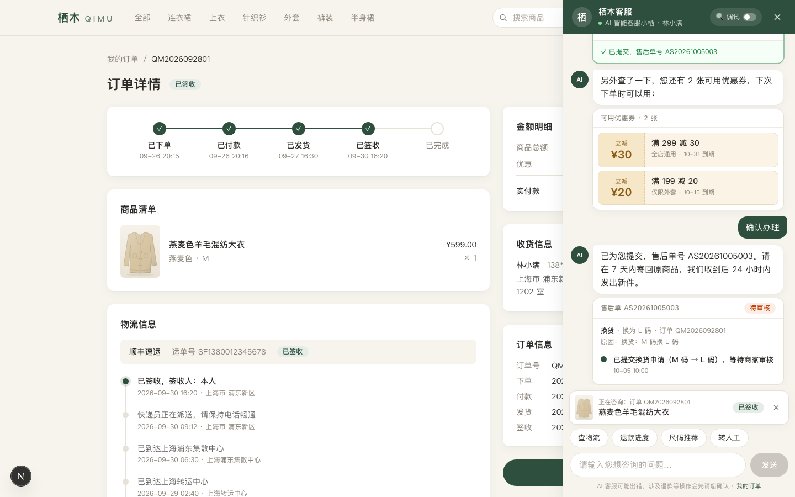

# 栖木客服 Agent · QIMU

**让简单问题快速解决，让复杂问题按需升级，让人工接得上。**

一个电商客服 Agent Demo，以虚构女装店「栖木 QIMU」为场景，串起买家咨询、订单查询、售后办理和卖家接管。

核心是一套**分层处理机制**：固定问题走规则，需要理解上下文的问题由 Jev 判断后交给对应流程，复杂诉求再交给大模型编排工具。风险检查贯穿自动服务，退款、换货、改地址等操作必须经过买家确认。

[体验引导演示](http://120.27.142.15/?demo=1) · [本地运行](#本地运行) · [系统架构](docs/ARCHITECTURE.md) · [评测报告](docs/reports/holdout-eval.md)

## 核心：每条消息该由谁处理？

客服消息的难度差别很大。「到哪了」只需要查订单物流，「上周买的外套换成 L，顺便看看有没有券」则需要找到订单、查库存、生成换货申请，再查优惠券。

栖木按任务需要分配处理方式，目标是控制等待时间与模型成本，同时保留风险升级和人工兜底。



风险检查与规则匹配并行。**L1 命中时，模型风险检查在后台继续，达到阈值后追加转人工；L1 未命中时，先检查模型风险再执行业务流程。** 关键词命中时会等待模型做有时限的复核，超时保留关键词转人工判断。明确要求人工、连续两轮未解决也会转接。

| 层级 | 负责什么 | 举个例子 |
|---|---|---|
| **L1 规则层** | 处理高频、固定、无歧义的表达 | 从订单页点「查物流」，直接用已知订单查询 |
| **L2 上下文层** | Jev 结合对话状态判断意图，交给对应业务流程执行 | 「退款到哪了」结合当前订单和售后信息查进度 |
| **L3 大模型层** | 为复杂诉求选择工具、安排执行顺序 | 「上周那件外套换成 L，顺便看看有没有券」 |
| **人工客服** | 接手风险、异常及自动流程无法完成的问题 | 穿后起红疹、投诉威胁、疑似诈骗、工具失败 |

**Jev 是做判断的模型**：一次请求返回意图、多诉求概率、风险分和情绪分。物流、库存、退款进度等事实来自工具，尺码来自确定性计算，咨询回复依据知识库并展示来源。L2 的咨询流程也可能调用大模型生成文字；升级到 L3 指的是让大模型编排多步工具。

## 从一句话到一次可确认的办理

以「**上周买的那件外套换成 L，顺便看看有没有券**」为例：

1. 找到当前买家的订单，确定「那件外套」指什么。
2. 查询 L 码库存，校验换货条件。
3. 生成换货确认卡，接着查询可用优惠券。
4. 买家点击「确认」后，服务端再次校验，再创建售后单。

**模型提出操作，买家确认后才执行。** 退款、换货、改地址、取消订单都遵循这一条，L2 和 L3 共用相同的工具与确认机制。工具从服务端上下文获取买家身份，执行时校验数据归属。

下面是仓库已有的端到端测试截图：确认换货后出现售后单，同时展示可用优惠券。店铺、买家和订单均为虚构数据。



## 人工接管后，已有信息能继续用

卖家在手机端可以看到待接管会话、转人工原因、对话摘要、已知订单与历史工具调用，随后接管回复，也可以交还 AI。

每条消息还会记录路由层级、意图、置信度、工具调用、延迟与费用。卖家可以从看板查看分层开销和低置信度样本，在规则页查看命中与误判记录，关闭容易误吞问题的规则，在知识库页导入资料并试搜。

这让系统的改进有具体入口：是规则过宽、上下文缺失、模型拿不准，还是工具执行失败，都能沿记录检查。

## 怎么体验

打开[引导演示](http://120.27.142.15/?demo=1)，按页面提示走六步；也可以在本地打开 `http://localhost:3000/?demo=1`。打开聊天窗的「调试」开关，可以看到每轮的处理层级。

| 步骤 | 体验什么 | 重点观察 |
|---|---|---|
| 1. 售前咨询 | 「我 160cm 50kg 穿什么码？这件能机洗吗」 | 尺码卡片、知识库资料来源 |
| 2. 订单物流 | 从订单页问「到哪了」 | 使用页面带入的订单上下文，显示物流时间线 |
| 3. 多步售后 | 换成 L 码，顺便查优惠券 | L3 调用工具；确认前后，申请状态不同 |
| 4. 风险转接 | 反馈穿后起红疹并要投诉 | 风险标签与「等待人工接入」状态 |
| 5. 人工接管 | 到卖家端接管并回复 | 转接原因、AI 上下文、买家收到人工消息 |
| 6. 路由看板 | 查看今天 / 近 7 天 | 各层占比、延迟、费用与评测结果 |

演示数据可在卖家端「设置 → 重置演示数据」恢复。公开演示设有访问限流和每日模型预算，额度耗尽后会切换简化模式。

## 已有验证与边界

以下为 **2026-10-04 留存的真实模型调用评测**，本次主页改写未重跑模型评测。

| 评测集 | 通过用例 | 路由准确率 | 报告 |
|---|---:|---:|---|
| 主评测集，60 条 | 57 / 60 | 96.7% | [逐条结果与失败原因](docs/reports/T06-eval.md) |
| 留出集，15 条，未用于本轮调优 | 13 / 15 | 86.7% | [逐条结果与失败原因](docs/reports/holdout-eval.md) |

主评测集曾用于发现问题并调整系统；留出集用于补充观察新问法下的表现。评测遇到分类器降级或异常时最多重试两次并采用最后一次结果，报告保留重试与降级记录。这些是小样本测试结果，不能直接视为线上解决率。

- **速度与成本有条件。** Jev 单次分类在本地热状态曾测得约 0.4 秒；这只覆盖判断阶段，完整回答还可能需要检索、工具和文本生成，部署环境与冷启动也会影响耗时。L1 规则匹配本身免费，但后台模型风险检查仍计费。[延迟实测](docs/reports/T01b-latency.md)
- **看板包含模拟历史流量。** 演示中新产生的调用有实际记录，历史种子流量用于展示统计效果，不能据此声称真实业务节省了多少成本。
- **复杂任务仍可能失败。** 留出集有分类器降级、多步任务转人工的失败案例；模型或工具超时会转人工。
- **当前是业务闭环 Demo。** 数据存储在本地 JSON，尚未接入真实电商平台、支付退款或生产身份认证；尚无运行时自动幻觉检测。店铺分析助手仍属后续任务。

## 本地运行

需要 **Node.js 20+**。技术栈：Next.js App Router、React、TypeScript、Tailwind CSS；模型调用统一经过 OpenRouter。

```bash
git clone https://github.com/yxtzan/qimu-cs-agent.git
cd qimu-cs-agent
npm install
test -f .env.local || cp .env.example .env.local
```

已有 `.env.local` 时保留现有配置。两种体验方式：

- **不填 API key**：后端使用关键词分类、模板回复和本地资料检索，适合查看基础流程；复杂 L3 任务会转人工。
- **使用真实模型**：在 `.env.local` 填入 `OPENROUTER_API_KEY`，保留 `NEXT_PUBLIC_USE_MOCK=0`。分类、生成、Agent 和向量模型均可通过环境变量配置，详见 [.env.example](.env.example)。

```bash
npm run seed
npm run dev
```

| 入口 | 地址 |
|---|---|
| 买家端：商城与客服聊天 | http://localhost:3000 |
| 引导演示 | http://localhost:3000/?demo=1 |
| 卖家端：会话与人工接管 | http://localhost:3000/seller |
| 路由看板 | http://localhost:3000/seller/dashboard |

`NEXT_PUBLIC_USE_MOCK=1` 是另一种模式：前端使用本地 mock，不请求后端，适合界面开发。它不能用于验证真实后端或模型效果。

<details>
<summary>开发与验证命令</summary>

```bash
npm run typecheck
npm run lint
npm run check-seed

# 首次运行浏览器测试前安装 Chromium
npx playwright install chromium
npm run e2e                          # 默认前端 mock 冒烟
NEXT_PUBLIC_USE_MOCK=0 npm run e2e   # 验证后端链路；有 key 时会调用真实模型

# 真实模型评测需先配置 key，会产生费用
npm run eval
npm run eval -- --cases holdout.json

npm run build
npm start
```

浏览器测试会复用已运行的本地服务，验证前应确认服务使用了预期模式。评测会重置演示数据，并更新本地评测报告。

公开部署的访客隔离、限流、预算与代理配置见 [部署说明](docs/DEPLOY.md)。

</details>

## 继续了解

| 想了解什么 | 从这里看 |
|---|---|
| 为什么这样分层，消息如何流转 | [系统架构](docs/ARCHITECTURE.md) · [架构决策](docs/DECISIONS.md) |
| 产品范围、页面与业务规则 | [产品需求](docs/PRD.md) · [数据规格](docs/DATA_SPEC.md) |
| API 与数据约定 | [接口契约](docs/CONTRACTS.md) · [类型定义](lib/types.ts) |
| 评测证据与已知问题 | [评测报告目录](docs/reports/) · [任务交接](docs/handoff/) |
| 按步骤讲解项目 | [演示剧本](docs/DEMO.md) |

<details>
<summary>项目协作方式</summary>

项目由人类调度与验收，Claude 负责规格、架构和审查，Codex 负责后端、大脑与数据，Cursor 负责前端及部分指定模块。

贡献前请先读 [AGENTS.md](AGENTS.md)，确认任务与目录归属。任务状态由 Claude 在 [任务看板](docs/TASKS.md) 维护；每个任务保留独立的 [交接记录](docs/handoff/)，契约变更通过 [问题文件](docs/questions/) 讨论。各任务提示词见 [docs/prompts/](docs/prompts/)。

</details>
